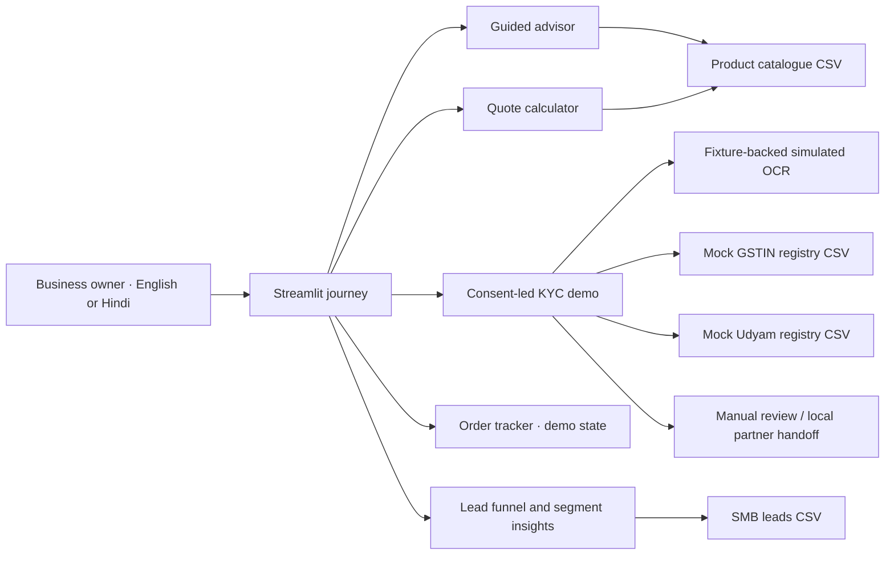

# Solution architecture

All components run locally in one Streamlit process. There is no external AI provider, database, or government API. The architecture diagram is also included as an editable slide in the submission deck.

